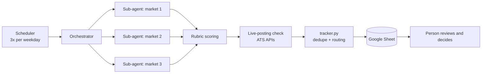

# Trove

A scheduled matching pipeline that scores job postings against a skills profile, checks that every posting is still live, and hands a person a short, ranked list to choose from. It never applies to anything: a human reads every shortlisted role and decides.

I built it in October 2026 for my own job search across six markets (UAE, Germany, Netherlands, Ireland, Luxembourg and India). The problem it solves is noise, not volume: most job boards are full of expired, duplicate or poorly matched postings, so Trove filters hard and keeps at most 20 roles per run.

> **Status:** in daily use since 18 Oct 2026.

## How it works

| Step | How |
|---|---|
| **Source** | Parallel LLM sub-agents search company career pages and ATS boards (Greenhouse, Lever, Ashby, Workday, Workable) per market, following the rules in [`docs/SEARCH_RULES.md`](docs/SEARCH_RULES.md). |
| **Score** | Each role gets a 1–5 fit score from a rubric: stack overlap, years asked and domain. Only 4s and 5s are kept; senior titles and 5+ year asks are dropped. |
| **Verify** | Each posting is re-checked through the ATS's own API (for example Greenhouse `boards-api`, Lever `postings`, Ashby `posting-api`). Dead or redirected links never reach the list. |
| **Route** | [`tools/tracker.py`](tools/tracker.py) maps the job title to the best-matching resume version and flags keywords from the posting that are missing from it. |
| **Track** | Rows go to a Google Sheet the person edits by hand, deduplicated against everything seen before. A read-only inbox pass keeps statuses up to date. |
| **Report** | A short summary after each run with the top 3 roles, and a weekly review. |



## Design choices

- **A human makes every decision.** Trove ranks and verifies; it has no ability to submit applications or send messages.
- **Verification beats search.** The first version trusted aggregators and many roles were already closed. Checking every posting against the ATS API fixed that.
- **Rules live in a plain file.** The rubric and filters are one Markdown file, so behaviour changes without code changes and every run is consistent.
- **The profile is config.** The same engine can match any skills profile to any set of postings.

## Evals (in progress)

The tracker holds about 95 real decisions where a person chose to act on a shortlisted role or skip it. That makes a labelled dataset for measuring the ranking:

- Precision of the top 20 against roles the person chose
- Rank correlation between fit score and those choices
- Tracked over time, so every rubric change shows whether it helped

## Run it yourself

```bash
pip install -r requirements.txt
python3 tools/tracker.py create                          # new tracker workbook
python3 tools/tracker.py add examples/roles.example.json # add roles (skips duplicates)
cd tools && python3 sheet_rows.py 1 2                    # rows in Google Sheet layout
```

Other tracker commands: `expire <ids>`, `remove <ids>` and `relink <file.json>`.

`resumes/build_resumes.py` builds every resume version from one source of facts, and `resumes/render.js` prints each to a one-page A4 PDF with Playwright.

## How it was built

Orchestration runs on scheduled [Claude Code](https://claude.ai/code) sessions that read [`docs/AGENT_PROMPT.md`](docs/AGENT_PROMPT.md) and the rules file, fan the search out to sub-agents, and use Google Sheets and Gmail connectors. I designed the workflow, the rubric and the rules and iterated on them daily from the results; Claude Code wrote most of the code under that direction.

---
Mariyam Pangarkar · [LinkedIn](https://linkedin.com/in/mariyam-pangarkar) · [Portfolio](https://mariyampangarkar19.github.io)
