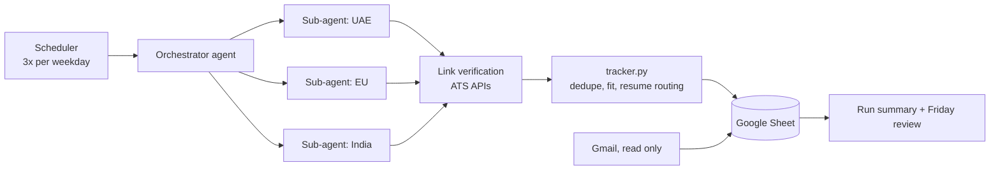

# Job Search Agent

An AI agent that runs my job search across six markets (UAE, Germany, Netherlands, Ireland, Luxembourg and India). Three times every weekday it finds new roles that fit my profile, checks that each link is live on the company's own careers site, picks the right resume for the role, and adds it to a Google Sheet. It also reads my inbox to keep application statuses up to date.

I built it while job hunting in October 2026, because applying well takes more time than finding roles. Most job boards are full of expired or duplicate postings, so the agent only adds a role after it has confirmed the posting itself.

> **Status:** in daily use since 18 Oct 2026. About 230 roles shortlisted and about 60 applications sent through it so far.

## What it does

| Step | How |
|---|---|
| **Find roles** | Parallel sub-agents search company career pages and ATS boards (Greenhouse, Lever, Ashby, Workday, Workable) per market, following the rules in [`docs/SEARCH_RULES.md`](docs/SEARCH_RULES.md). |
| **Score fit** | Each role gets a 1–5 fit score based on stack overlap, years asked and domain. Only 4s and 5s are kept, and senior titles or 5+ year asks are dropped. |
| **Verify links** | Before a role is added, its posting is re-checked through the ATS's own API (for example Greenhouse `boards-api`, Lever `postings`, Ashby `posting-api`). Dead or redirected links never reach the sheet. |
| **Route a resume** | [`tools/tracker.py`](tools/tracker.py) maps the job title to one of three resume versions (AI Engineer, Software Engineer, Technical Analyst) and flags JD keywords missing from my resume. |
| **Track** | Rows go to a local Excel mirror and to a Google Sheet that I edit by hand. A dashboard tab shows response rate by market and by resume. |
| **Inbox sync** | A read-only Gmail pass marks confirmations, assessments, interviews and rejections in the sheet. |
| **Report** | A short summary after each run with the top 3 roles, and a weekly review every Friday. |



## Resumes from one source

[`resumes/build_resumes.py`](resumes/build_resumes.py) keeps every fact about my experience in one place and builds three role versions for three markets (nine PDFs). Each version only changes the order and emphasis of the same bullets, and the market changes only the status line. [`resumes/render.js`](resumes/render.js) uses Playwright to print each one to A4, shrinking the font until it fits on one page.

## Run it yourself

```bash
pip install -r requirements.txt
python3 tools/tracker.py create                          # new Job_Tracker.xlsx
python3 tools/tracker.py add examples/roles.example.json # add roles (skips duplicates)
cd tools && python3 sheet_rows.py 1 2                    # rows in Google Sheet layout
```

The other tracker commands are `expire <ids>`, `remove <ids>` and `relink <file.json>`.

To build resumes, put your contact line in `resumes/contact.json` (gitignored) and run `python3 resumes/build_resumes.py` with Node and Playwright installed.

## How it was built

The orchestration runs on [Claude Code](https://claude.ai/code): scheduled sessions read [`docs/AGENT_PROMPT.md`](docs/AGENT_PROMPT.md) and the search rules, spread the search across sub-agents, and use Google Sheets and Gmail connectors. I designed the workflow, the fit rubric and the rules, and iterated on them daily as results came in. Claude Code wrote most of the code under that direction.

What I learned:
- **Verification matters more than search.** The first version added roles from aggregators, and many were already closed. Checking every posting against the ATS API fixed that.
- **Fewer resumes work better.** Eight resume versions spread my profile too thin, so I cut them to three.
- **Plain rules files beat long prompts.** Keeping the rules in one Markdown file means each run behaves the same, and I can change the behaviour without touching code.

## Roadmap
- Response-rate analysis per resume version, to drive the next resume rewrite
- Auto-drafted, tailored cover notes for top-fit roles (sent by me, never automatically)
- Package the agent so others can run it with their own rules file

---
Mariyam Pangarkar · [LinkedIn](https://linkedin.com/in/mariyam-pangarkar)
